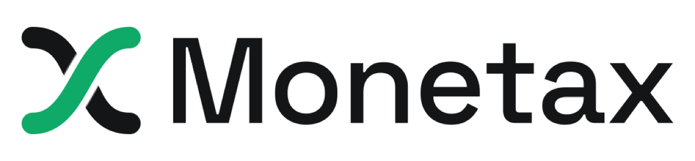
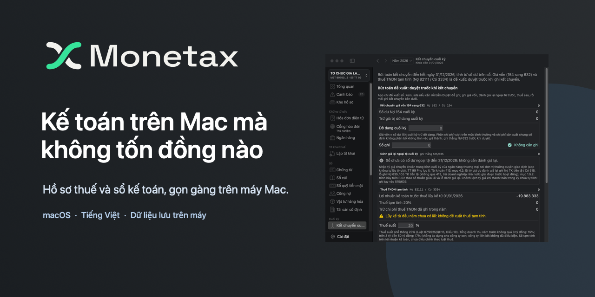

# Monetax

<picture>
  <source media="(prefers-color-scheme: dark)" srcset="assets/lockup-ngang-trang.png">
  
</picture>

App macOS miễn phí để lưu, xem hồ sơ thuế và ghi sổ kế toán cho nhiều người nộp thuế, mỗi người trong một kho riêng trên máy Mac của bạn.

**Kế toán trên Mac mà không tốn đồng nào**

Monetax không phải phần mềm của Cục Thuế. App không thay thế HTKK, iTaxViewer hay cổng thuế điện tử, và không nộp
tờ khai thay bạn.

## App làm gì (bản 1.0)

- **Kho hồ sơ và trình xem tờ khai.** Kéo thả tờ khai XML đã nộp hoặc cả thư mục. App xếp theo loại tờ khai và kỳ,
  kiểm số chuyển kỳ (01/GTGT), so chỉ tiêu giữa các lần khai. Xem tờ khai bằng biểu mẫu của Cục Thuế, kiểm chữ ký số,
  in và xuất PDF.
- **Hóa đơn điện tử.** Nhập XML/ZIP, kiểm lỗi và chữ ký, tổng hợp theo tháng, đề xuất bút toán.
- **Ngân hàng.** Đọc sao kê Excel (.xlsx), CSV, MT940, camt.053 và PDF dạng chữ của một số ngân hàng; khớp giao dịch
  với hóa đơn; ghi sổ.
- **Sổ kế toán** theo TT 99/2025, TT 133/2016 và sổ hộ kinh doanh theo TT 152/2025: chứng từ, sổ cái, sổ quỹ, công
  nợ, vật tư, tài sản cố định, kết chuyển, khóa sổ, báo cáo tài chính. In, xuất CSV và Excel.
- **Hộ kinh doanh trường hợp B và C.** Có đề xuất ngành nghề, tỷ lệ thuế; GTGT và TNCN được tính theo ngưỡng doanh thu
  1 tỷ đồng/năm.
- **Cài đặt dạng thẻ:** giao diện, cỡ chữ, người nộp thuế, sổ kế toán, sao lưu và hệ thống.
- **Cảnh báo, Tổng quan, bảng lệnh ⌘K.**
- **Lập tờ khai 01/GTGT.** Nhập, kiểm tra và kết xuất XML để nộp tại Thuế điện tử; các mẫu khác hiện Chưa hỗ trợ và
  hiển thị cổng nộp tương ứng.
- **Ô tiền.** Khi gõ số tiền, ô tự thêm dấu chấm phân nhóm.
- **Cổng hóa đơn (thử nghiệm).** Mở trang hóa đơn điện tử của Tổng cục Thuế trong app; bạn tự đăng nhập, app dùng
  phiên đó để tải hóa đơn. Phần này chưa được xác minh bằng một lần dùng thật, có thể không chạy.

Chưa có trong 1.0: mẫu tờ khai ngoài 01/GTGT; hướng dẫn cho người mới (dự kiến bản 1.0.1); sổ HKD S3a; chuyển sổ giữa TT 133 và TT 99; đổi sổ HKD trường hợp
B ↔ C khi đã có số liệu; cửa sổ eTax; cập nhật mẫu HTKK trong app; cảnh báo từng kho trên danh sách người nộp thuế;
đề xuất nghiệp vụ mua vào/sao kê và nối TSCĐ cho HKD C. Cổng hóa đơn vẫn ở trạng thái thử nghiệm.

## Yêu cầu

- macOS 14 (Sonoma) trở lên.
- Máy Mac chip Apple (M1 trở lên). Bản 1.0 chỉ build cho chip Apple, không chạy trên Mac chip Intel.

## Tải và cài

1. Vào mục **Releases** của repo này, tải tệp `Monetax-<phiên bản>.dmg`.
2. Mở tệp `.dmg`, kéo **Monetax** vào thư mục **Applications**.
3. Mở **Monetax** từ thư mục Applications.

### Mở lần đầu

App chưa được Apple công chứng (notarize), chỉ ký ad-hoc. Lần đầu mở, macOS báo không mở được vì không kiểm tra được
nhà phát triển. Cách mở:

1. Mở app một lần như bình thường, bấm **Xong** (hoặc **OK**) ở hộp cảnh báo.
2. Vào **Cài đặt hệ thống → Quyền riêng tư & Bảo mật**, kéo xuống phần **Bảo mật**.
3. Có dòng báo "Monetax" đã bị chặn: bấm **Vẫn mở**, rồi nhập mật khẩu máy hoặc dùng Touch ID để xác nhận.

Tên các mục trên lấy theo macOS 14 và 15 bản tiếng Việt; bản macOS khác có thể ghi hơi khác. Chỉ làm vậy với tệp
`.dmg` tải từ trang Releases của repo này.

## Cập nhật

App tự cập nhật bằng [Sparkle](https://sparkle-project.org). Từ lần mở thứ hai, app hỏi có tự kiểm bản cập nhật
không; chọn **Tự kiểm** thì mỗi ngày app xem một lần có bản mới trên trang Releases. Kiểm ngay: menu **Monetax →
Kiểm tra bản cập nhật…**. Khi có bản mới, app hiện ghi chú phát hành và chỉ cài khi bạn bấm **Cài bản cập nhật**;
app thoát, thay bản mới vào chỗ cũ rồi mở lại. Tệp cập nhật được kiểm chữ ký số (EdDSA) của người phát hành trước khi
cài; tệp bị sửa hay không đúng chữ ký thì bị từ chối. Dữ liệu trong kho không bị đụng tới.

Cập nhật chỉ chạy khi app nằm ở chỗ ghi được (ví dụ thư mục Applications). Nếu bạn mở app thẳng từ tệp `.dmg` hay từ
thư mục Tải về mà chưa kéo vào Applications, hãy kéo vào Applications trước. Muốn cập nhật bằng tay: tải `.dmg` mới ở
Releases và kéo đè lên bản cũ.

## Dữ liệu của bạn

- Mọi dữ liệu nằm trên máy: `~/Library/Application Support/Monetax/Kho` (tờ khai, hóa đơn, sao kê, sổ kế toán).
- App không gửi dữ liệu của bạn lên máy chủ nào. App chỉ kết nối mạng để: kiểm bản cập nhật trên GitHub (tải tệp
  `appcast.xml` của bản phát hành mới nhất, mỗi ngày một lần; tắt được ở **Monetax → Cài đặt… → Cập nhật**), kiểm
  thu hồi chứng thư số khi xem chữ ký, và mở Cổng hóa đơn khi bạn tự đăng nhập.
- **Sao lưu.** App tự sao lưu kho mỗi ngày và trước các thao tác lớn (kết chuyển, khóa sổ, ghi sổ hàng loạt), giữ 10
  bản ở thư mục "Sao lưu tự động" cạnh thư mục kho. Các bản này nằm trên cùng máy: hãy định kỳ dùng **Tệp → Sao lưu
  kho…** để chép một bản ra ổ khác. Khôi phục bằng **Tệp → Khôi phục kho từ bản sao lưu…**; kho đang dùng được giữ
  lại, không bị xóa.

## Miễn trừ trách nhiệm

Monetax là phần mềm miễn phí, không phải của Cục Thuế và không thay thế phần mềm HTKK, iTaxViewer hay cổng thuế
điện tử. Số liệu, bút toán và báo cáo do app đề xuất phải được bạn kiểm tra trước khi dùng để kê khai, nộp hoặc lưu
trữ. Người làm app không chịu trách nhiệm về thiệt hại phát sinh từ việc dùng app.

App kèm biểu mẫu XSLT, danh mục và kho chứng thư lấy từ bộ cài iTaxViewer của Cục Thuế. Danh sách thành phần bên
thứ ba và giấy phép: trong app, **Trợ giúp → Giấy phép bên thứ ba…**.

## Báo lỗi

- Dùng mục **Issues** của repo này (cần tài khoản GitHub). Trong app: **Trợ giúp → Báo lỗi…** có hướng dẫn và nút
  sao chép thông tin phiên bản.
- Mô tả: bạn đang làm gì, ở trang nào, mong đợi gì, app đã làm gì, lỗi có lặp lại không.
- **Trang Issues là công khai.** Trước khi đính kèm ảnh hay tệp, che mã số thuế, tên người nộp thuế, tên khách hàng
  và nhà cung cấp, số tiền, số hóa đơn, số tài khoản. Không gửi tệp kho, sổ (`.sqlite`), bản sao lưu hay tờ khai XML
  thật.
- Nhật ký lỗi ở `~/Library/Logs/Monetax/` (**Trợ giúp → Mở thư mục nhật ký**). Nhật ký chỉ ghi thời điểm, trang, loại
  lỗi và thông điệp kỹ thuật đã che số và tên tệp; vẫn nên mở ra đọc trước khi đính kèm. App không tự gửi gì.

## Hạn chế đã biết

- App chưa công chứng: phải mở lần đầu theo hướng dẫn ở trên. Tự cập nhật đã thử trên máy phát triển; chưa thử trên
  máy khác (bản tự cập nhật có thể lại phải "Vẫn mở" lần nữa: nếu gặp, xin báo ở Issues).
- Cổng hóa đơn là thử nghiệm, chưa xác minh với một lần đăng nhập thật.
- Sao kê: chưa đọc tệp có mật khẩu, `.xls` đời cũ (BIFF5), PDF dạng ảnh quét (không có OCR) và PDF của ngân hàng
  chưa có mẫu. Nên dùng `.xlsx` hoặc CSV tải từ ngân hàng.
- Hóa đơn điều chỉnh, thay thế: cách đọc số tiền và hạn thanh toán chưa được kiểm trên đủ mẫu thật.
- Ngoại tệ: chưa tính chênh lệch tỷ giá khi thanh toán; chưa nhập nguyên tệ ở số dư đầu kỳ.
- Thuế TNDN: chưa có nhắc ghi thuế tạm tính cuối quý; năm tài chính khác năm dương lịch chưa hỗ trợ.
- Hạn nộp: chưa tính ngày lễ, Tết.
- Báo cáo tài chính XML: chưa thử nhập vào HTKK hay eTax; thiếu mã cơ quan thuế, địa bàn, ngành nghề; chưa có báo cáo
  giữa niên độ.
- Bản xuất Excel chưa được mở thử bằng Excel và Numbers.
- Giao diện chỉ có tiếng Việt.
- Sổ hộ kinh doanh chưa có S3a, chưa thể chuyển trường hợp B ↔ C khi sổ đã có số liệu; sổ trường hợp C chưa đề xuất
  nghiệp vụ từ hóa đơn mua vào hoặc sao kê và chưa nối với TSCĐ.
- Chưa có cửa sổ eTax, cập nhật mẫu HTKK trong app, hay cảnh báo từng kho ở danh sách người nộp thuế. Cổng hóa đơn vẫn
  mang nhãn thử nghiệm cho tới khi xác minh tải hóa đơn bằng một lần đăng nhập thật.
